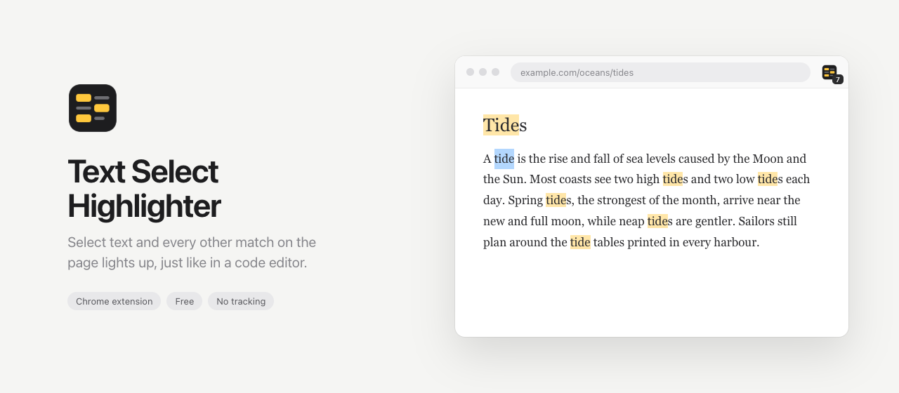
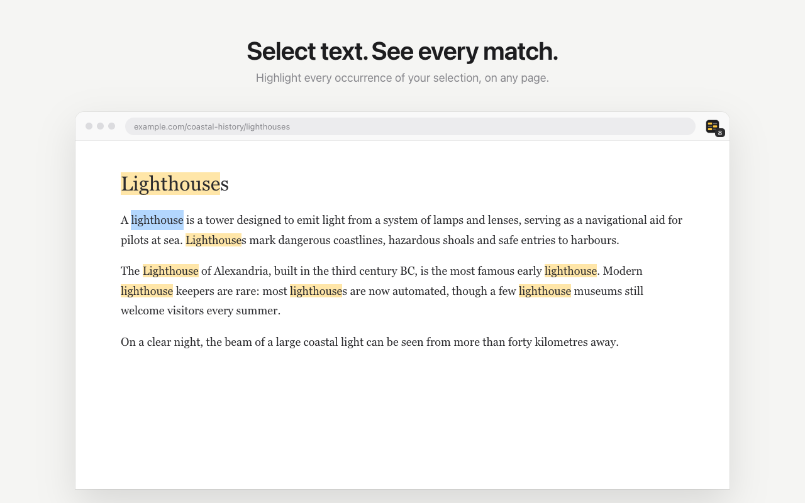
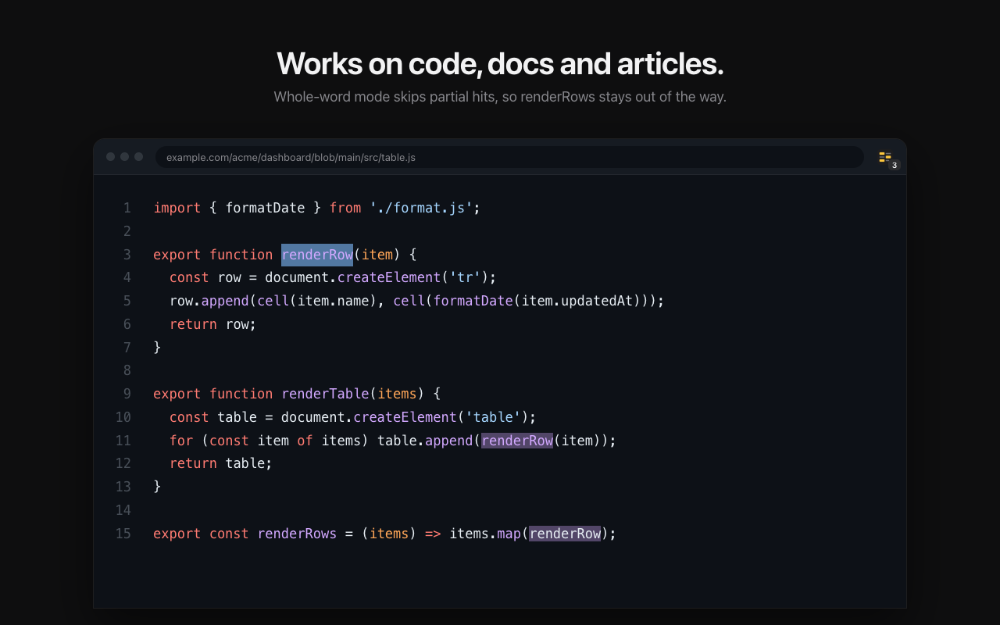
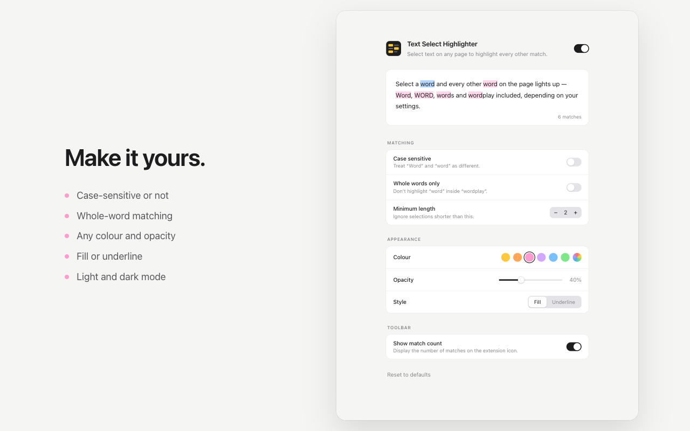

<picture>
  <source media="(prefers-color-scheme: dark)" srcset="docs/banner-dark.png" />
  
</picture>

<p align="center">
  <a href="#install">Install</a> ·
  <a href="#features">Features</a> ·
  <a href="#settings">Settings</a> ·
  <a href="#how-it-works">How it works</a> ·
  <a href="#development">Development</a> ·
  <a href="PRIVACY.md">Privacy</a>
</p>

<br />

Code editors highlight every match of whatever you select. This Chrome extension does the same for every web page: articles, docs, code, search results.

<p align="center">
  
  
</p>

## Features

- **Instant highlighting.** Select some text and every other match lights up. Your own selection keeps its normal colour.
- **Your rules.** Choose case-sensitive or case-insensitive matching, turn on whole-word matching, and set a minimum selection length.
- **Your colours.** Pick any colour and opacity, with a fill or an underline.
- **Match count** on the toolbar icon.
- **Doesn't touch the page.** Highlights are painted by the browser, so layouts never shift and sites don't break.
- **Private.** Everything happens on your device. No network requests, no analytics, no data collected.

## Install

**From source** (until it's on the Chrome Web Store):

1. Clone or [download](https://github.com/ytarfa/text-select-chrome-extension/archive/refs/heads/main.zip) this repo
2. Open `chrome://extensions` and turn on **Developer mode**
3. Click **Load unpacked** and pick the repo folder

Requires Chrome 110 or later.

## Settings

Click the extension's toolbar icon to open the settings. Changes apply instantly to every open tab, and the preview at the top shows exactly what you'll get.

<p align="center">
  
</p>

| Setting | Default | |
| --- | --- | --- |
| Enabled | On | Master switch, in the page header |
| Case sensitive | Off | Treat `Word` and `word` as different |
| Whole words only | Off | Don't match `word` inside `wordplay` |
| Minimum length | 2 | Ignore shorter selections, so a single letter doesn't light up the whole page |
| Colour | Amber | Six presets or any custom colour |
| Opacity | 45% | 10–100% |
| Style | Fill | Fill or underline |
| Show match count | On | Number of matches on the toolbar icon |

Settings are stored with `chrome.storage.sync`, so they follow you to other devices if Chrome sync is on.

## How it works

The content script waits for the selection to settle, then:

1. Walks the page's text nodes and joins them into one string, so a match still works when it's split across styled spans, as in syntax-highlighted code. Text from separate blocks (paragraphs, list items, table cells) is kept apart so matches can't run between them.
2. Searches that string for the selection. Spaces in the selection match any run of whitespace, because rendered text rarely matches the DOM exactly.
3. Turns each match into a `Range`, skipping hidden elements and the selection itself, and hands the ranges to the [CSS Custom Highlight API](https://developer.mozilla.org/en-US/docs/Web/API/CSS_Custom_Highlight_API).

Because the API paints ranges without wrapping them in elements, the page's DOM is never modified. The highlight style is added as a constructed stylesheet, so it also works on sites with a strict Content Security Policy.

## Development

Plain JavaScript with no build step and no dependencies.

```
manifest.json         Manifest V3 config
src/shared.js         Defaults, matching and highlight styling (content script + settings page)
src/content.js        Watches the selection and paints matches
src/background.js     Toolbar badge and opening the settings page
options/              Settings page
icons/                icon.svg and the rendered PNGs
store/                Chrome Web Store listing copy, screenshots and promo tile
docs/                 README banners
scripts/              Packaging and image rendering
```

After editing, click the reload button on the extension's card in `chrome://extensions`, then refresh the tabs you're testing in.

| Script | |
| --- | --- |
| `scripts/package.sh` | Builds `dist/text-select-highlighter-<version>.zip` for the Chrome Web Store |
| `scripts/render-store-assets.sh` | Re-renders the store screenshots, promo tile and README banners with headless Chrome, using the real extension code |

To regenerate the icons after editing `icons/icon.svg`:

```sh
cd icons && for s in 16 32 48 128; do rsvg-convert -w $s -h $s icon.svg -o icon-$s.png; done
```

Publishing notes (listing copy, permission justifications, privacy answers) are in [`store/listing.md`](store/listing.md).
